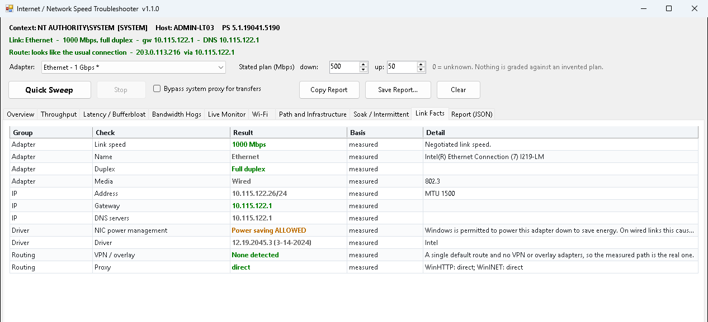

# NetSpeed Troubleshooter

A **PowerShell 5.1** GUI for the ticket that says *"the internet is slow"*. A one-minute **Quick Sweep** answers the questions behind most of those tickets, and deep dives back it up: per-process bytes, a live traffic monitor, Wi-Fi, path and DNS, and a soak mode for faults that only happen sometimes.

From [ihavenoram.com](https://ihavenoram.com): field notes for ADHD techs running managed services.



*The screenshot is the real GUI on a **fictional** machine: the host, addresses and figures are invented.*

```
netspeed\
  Launch-NetSpeed-Troubleshooter.cmd   <- run this (the GUI)
  NetSpeed-Troubleshooter-Gui.ps1      <- the GUI
  NetSpeed-Troubleshooter.Helpers.ps1  <- all the measurement logic
  Launch-NetSpeed_HTML_Report.cmd      <- opens the HTML report renderer
  NetSpeed_HTML_Report.ps1             <- turns a saved report into one self-contained HTML page
  Launch-Watch-NsEgress.cmd            <- one egress sample (pass -Report true to read the history)
  Watch-NsEgress.ps1                   <- records the public address on a schedule, to catch WAN failover
```

**New here? Start with [QUICKSTART.md](QUICKSTART.md).** No installer and no deploy step: copy the folder to the machine and run the launcher.

## Download

Grab **`netspeed.zip`** from **[Releases](../../releases/latest)**. It holds one folder, `netspeed\`, with only what runs: the scripts and a `.cmd` launcher for each. Copy that folder to the PC or server (for example `C:\temp\netspeed`); this README and the docs stay here on GitHub. The SHA-256 checksum is in the release notes and in the `.sha256` file beside the zip:

```powershell
Get-FileHash .\netspeed.zip -Algorithm SHA256
```

Extract it, copy the `netspeed` folder wherever you need it (for ScreenConnect Backstage, drag it to `C:\temp`), and run the launcher. WinForms needs `-STA`, and the launcher supplies it:

```bat
Launch-NetSpeed-Troubleshooter.cmd
```

No admin rights needed, except for the ETW deep capture, which disables itself with a stated reason when it can't run. Built to run in a ScreenConnect Backstage session, including as SYSTEM. Add `-NoHideConsole` to watch for errors.

---

## Why it exists

"The internet is slow" is rarely the internet. It's a patch lead that negotiated 100 Mbps, a router whose buffer adds 400 ms the moment anyone uploads a file, OneDrive syncing a camera roll, or a site that quietly failed over to its backup 4G link. A speed test answers none of those, and a speed test that *looks fine* sends you to the ISP for nothing.

Quick Sweep answers, in about a minute:

| Question | How |
| :--- | :--- |
| **Is the physical link the cap?** | The negotiated speed and duplex, coloured red in the title strip before anything is measured |
| **What does the link actually deliver?** | Several concurrent HTTPS streams to Cloudflare, timed on body transfer only, reported as the 90th percentile *with* the median and sustained rate |
| **Does latency collapse under load?** | Idle latency, then latency *while the link is saturated*, graded on the **increase** (bufferbloat), plus where the queue is: this building or the WAN uplink |
| **Is something on this PC eating the link?** | Delivery Optimization and BITS counters, plus every process with an internet connection, classified (sync, update, backup, RMM, browser...) |
| **Is this even the usual connection?** | Which box traffic actually leaves through, what that box is, and the fingerprints of a backup or tunnelled path |

## The tabs

- **Overview**: one line per subscore and an overall result that is the **worst measured** subscore. No 0-100 score, no averaging.
- **Throughput**: the built-in Cloudflare engine (no download, works under SYSTEM), plus an **Ookla** button for when you need a speedtest.net Result URL to hand an ISP.
- **Latency / Bufferbloat**: idle versus loaded latency to the gateway, 1.1.1.1 and an HTTPS endpoint, graded A+ to F on the increase.
- **Bandwidth Hogs**: inference from connection counts, plus a 20-second **ETW deep capture** for real per-process bytes (admin only).
- **Live Monitor**: the adapter's own counters once a second and the top talkers, so you can watch while the user reproduces the fault. The tool's own traffic is labelled, never hidden.
- **Wi-Fi**: signal, band, channel, negotiated rate and co-channel neighbours.
- **Path and Infrastructure**: traceroute, DNS resolver timing against public resolvers, path MTU, VPN, proxy, QoS, the egress device and what it identifies itself as.
- **Soak / Intermittent**: 15, 60 or 240 minutes of 1 Hz monitoring for dropouts.
- **Link Facts** and **Report (JSON)**: adapter, driver and power-saving facts, and the whole report to copy or save.

## Honest about its limits

Every row says how it was arrived at: `measured`, `inference`, `server-reported`, `vendor tool`, `not measured` or `withheld`. A number below the instrument's resolution is withheld rather than published, and something that wasn't measured never counts against the result. Read these before trusting a clean report:

- **It sees this PC only.** Another device saturating the same link (a NAS, a TV, the receptionist's Dropbox) is invisible to it. A clean report means *nothing on this machine is responsible*, not that the link is idle.
- Throughput is a **single-CDN** measurement: the path to one Cloudflare edge, not to every service the customer uses. Use the Ookla button for an independent figure.
- **Upload timing includes one round trip**, so it reads pessimistically on high-latency links.
- The built-in engine is single-threaded and **tops out around 900 Mbps**. Past that it reports a floor and points you at Ookla.
- The **Wi-Fi tab has not been tested on real wireless hardware** yet, and assumes English `netsh` output (it reports *unsupported* rather than guessing on other languages).
- A clean soak only proves nothing happened **while it was watching**.

The full list, and the measured facts each design decision rests on, are in [docs/TECHNICAL.md](docs/TECHNICAL.md).

## Privacy and safety

- **Read only on the machine.** The only things it changes: a private ETW trace session during a deep capture (stopped in a `finally` and on close), files you choose to save, and a scheduled task, but only if you install the egress watch with `-Install "true"`.
- **Who it talks to:** `speed.cloudflare.com` for throughput and loaded latency; ICMP to `1.1.1.1` and your default gateway; DNS timing against your configured resolvers and 1.1.1.1, 8.8.8.8, 9.9.9.9 and 208.67.222.222; and `checkip.amazonaws.com`, `api.ipify.org` or `ifconfig.me` for the public address. To identify the gateway it connects to a handful of management ports (80, 443, 8080, 8443, 22, 23) on **that one address** only. It never scans a range.
- **Data use is capped in code**, not in the UI: 2 GB down and 1 GB up per run, 30 s per direction, and a 20 s cooldown between transfer tests. A cellular adapter is detected and drops the test to a 3 s, 50 MB profile automatically.
- **Ookla only runs when you press its button and confirm.** It then downloads the official CLI from `install.speedtest.net` (about 1 MB) into **this account's own profile**, never a shared folder, and checks it against a pinned SHA-256 before every run, because `speedtest.exe` isn't code-signed. Running it accepts Ookla's licence and GDPR notice on the user's behalf, and the Result URL it produces is public on speedtest.net.
- **Nothing it schedules as SYSTEM can be changed by a standard user.** The egress watch refuses to install its scheduled task from a folder a standard user could change (`C:\temp`, Downloads and `C:\ProgramData` all qualify), so it's installed from `C:\Program Files`. The ETW trace and the Ookla CLI live in the running account's own profile.
- **No telemetry.** Reports stay where you save them.

## Requirements

- Windows 10/11 or Server 2016+ with **Windows PowerShell 5.1**. Server 2012 R2 (PowerShell 4.0) starts and reports, but its throughput figures have read near zero there for a reason not yet found, so don't trust them on that OS.
- Outbound HTTPS to `speed.cloudflare.com`
- Admin rights only for the ETW deep capture, and for installing the egress watch

## About

Built with AI assistance (Claude) for real MSP support work. It's provided as is, with no warranty: read what it does before you run it, and check how your EDR will react to a tool that opens many HTTPS streams, pings, traces routes and starts an ETW session.

MIT licensed; see [LICENSE](LICENSE).
